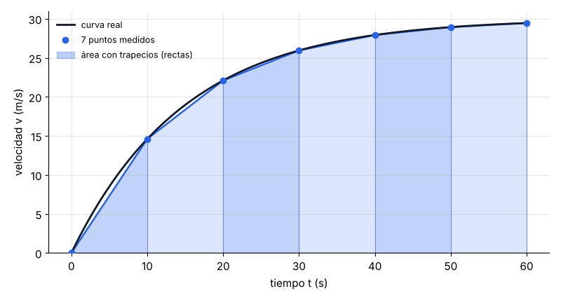
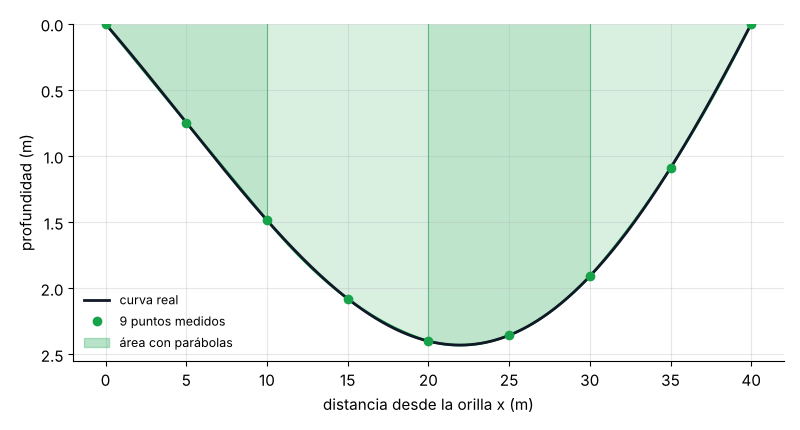
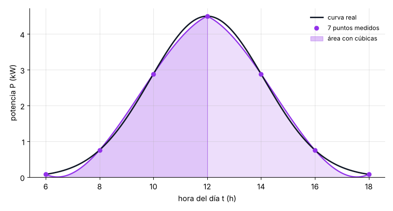
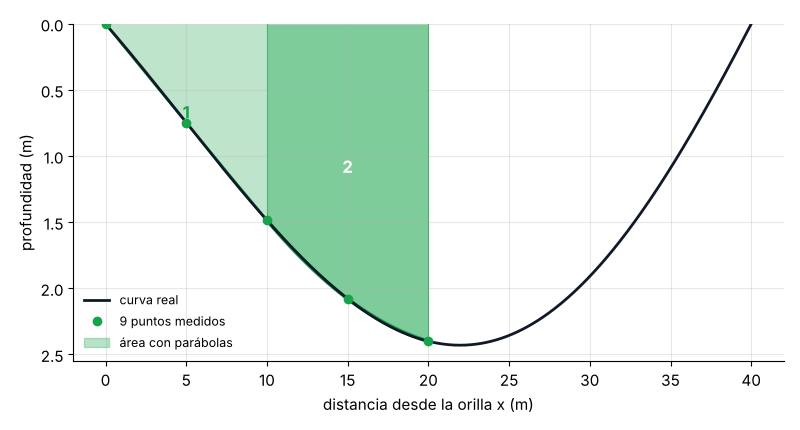

# ∫ Integración Numérica: Trapecio, Simpson 1/3 y Simpson 3/8

Proyecto de **Análisis Numérico**, Ingeniería de Sistemas, Universidad Simón Bolívar.

### 👉 [Abrir la app en el navegador](https://neyderjavier.github.io/autoescalado-punto-fijo/) (no requiere instalar nada)

> La primera carga tarda entre 20 y 60 segundos porque Python se ejecuta dentro del navegador. Funciona en Chrome, Edge y Safari.

Una app didáctica con **tres módulos**, uno por método. Cada módulo explica la idea, resuelve un problema de la vida real, dibuja las figuras que aproximan el área, las anima **figura por figura** y hace el cálculo **paso a paso**, como en el cuaderno.

---

## 🚀 Cómo ejecutarlo

```bash
git clone https://github.com/NeyderJavier/autoescalado-punto-fijo.git
cd autoescalado-punto-fijo
pip install -r requirements.txt

streamlit run app.py          # abre la app en el navegador
python -m pytest -v           # 26 pruebas automáticas
```

En **Visual Studio Code**, las pruebas aparecen solas en el panel **Testing** (ícono del matraz).

---

## 📐 Módulo 1 · Regla del Trapecio: distancia de un carro

Un carro acelera durante 60 s y el velocímetro se lee cada 10 s. La distancia es el área bajo la curva de velocidad.

$$\int_a^b f(x)\,dx \approx \frac{h}{2}\Big[f(x_0) + 2f(x_1) + \cdots + 2f(x_{n-1}) + f(x_n)\Big]$$

- Reemplaza la curva por **rectas**. Sirve con **cualquier n**.
- Pesos: `1, 2, 2, …, 2, 1`.



## 🌿 Módulo 2 · Regla de Simpson 1/3: sección de un río

Se mide la profundidad cada 5 m a lo ancho de un río de 40 m. El área de la sección, multiplicada por la velocidad del agua, da el caudal.

$$\int_a^b f(x)\,dx \approx \frac{h}{3}\Big[f(x_0) + 4f(x_1) + 2f(x_2) + 4f(x_3) + \cdots + 4f(x_{n-1}) + f(x_n)\Big]$$

- Reemplaza la curva por **parábolas** (3 puntos cada una). **n debe ser par**.
- Pesos: `1, 4, 2, 4, …, 4, 1`.



## ☀️ Módulo 3 · Regla de Simpson 3/8: energía de un panel solar

La potencia de un panel se mide cada 2 horas, entre las 6:00 y las 18:00. La energía del día es el área bajo la curva de potencia.

$$\int_a^b f(x)\,dx \approx \frac{3h}{8}\Big[f(x_0) + 3f(x_1) + 3f(x_2) + 2f(x_3) + \cdots + 3f(x_{n-1}) + f(x_n)\Big]$$

- Reemplaza la curva por **cúbicas** (4 puntos cada una). **n debe ser múltiplo de 3**.
- Pesos: `1, 3, 3, 2, 3, 3, 2, …, 3, 3, 1`.



---

## 🎬 Figura por figura

En cada módulo, el botón **Siguiente ▶** agrega una figura a la vez y muestra cuánto suma cada una. Al final, la suma coincide con la fórmula completa.



---

## 📊 Resultados con n = 6

| Problema | Valor exacto | Trapecio | Simpson 1/3 | Simpson 3/8 |
|---|---|---|---|---|
| 🚗 Distancia del carro | 1358.24 m | 1342.00 m (1.20 %) | 1357.78 m (0.034 %) | 1357.26 m (0.073 %) |
| 🌊 Sección del río | 61.12 m² | 59.71 m² (2.30 %) | 61.14 m² (0.043 %) | 61.18 m² (0.10 %) |
| ☀️ Energía del panel | 23.82 kWh | 23.75 kWh (0.29 %) | 23.86 kWh (0.19 %) | 23.28 kWh (2.25 %) |

Entre paréntesis está el error relativo. Simpson 1/3 es el más preciso en los tres casos. Simpson 3/8 se usa cuando el número de franjas es **impar** (3, 9, 15…), porque ahí Simpson 1/3 no se puede aplicar.

---

## 📁 Estructura

```
app.py                 Menú principal (4 páginas)
paginas/
  inicio.py            Qué es integrar y cómo usar la app
  modulo_trapecio.py   Módulo 1
  modulo_simpson13.py  Módulo 2
  modulo_simpson38.py  Módulo 3
metodos/
  trapecio.py          Cada método en su propio archivo (≈40 líneas)
  simpson_13.py
  simpson_38.py
problemas.py           Carro, río, panel solar y funciones para practicar
graficas.py            Dibujos de las figuras y la animación
componentes.py         Piezas de pantalla comunes a los módulos
tests/test_metodos.py  26 pruebas automáticas
index.html             Página web (ejecuta la app en el navegador con stlite)
```

## ✅ Pruebas automáticas

Cada prueba tiene una razón matemática. Por ejemplo:

- El trapecio es **exacto con rectas**, y los dos Simpson son **exactos con polinomios de grado 3**.
- Al **duplicar n**, el error del trapecio baja **4 veces**, y el de Simpson, **16 veces**.
- Simpson 1/3 **rechaza n impar**, y Simpson 3/8 rechaza **n que no sea múltiplo de 3**.
- Los resultados coinciden con los valores exactos de los tres problemas.

---

**Autor:** Neyder Javier Rojas Lasso · [GitHub](https://github.com/NeyderJavier) · [LinkedIn](https://www.linkedin.com/in/neyder-javier-rojas-lasso-952a36196)
