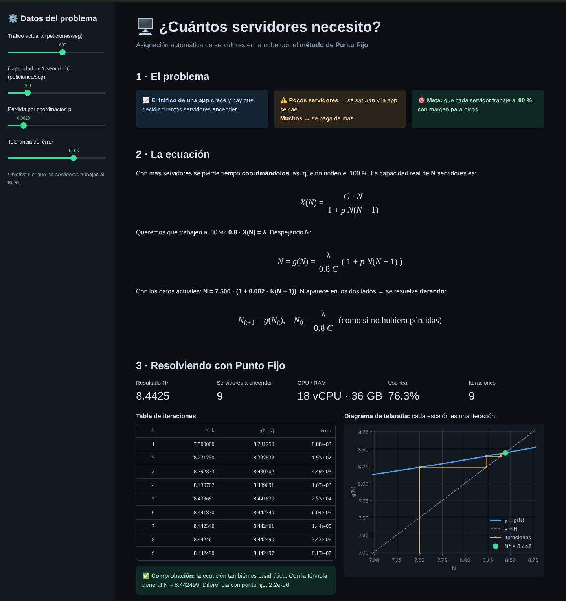
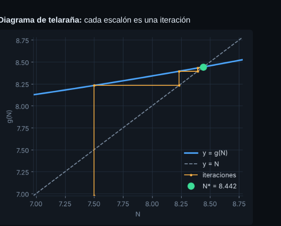
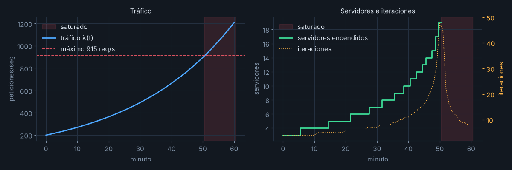
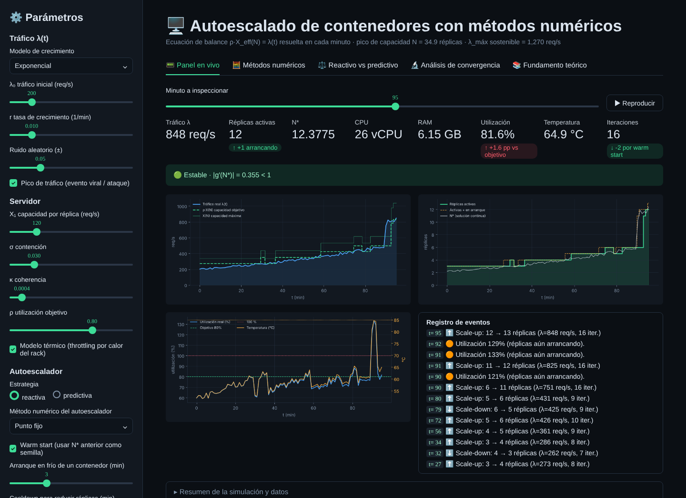

# 🖥️ ¿Cuántos servidores necesito?

### Asignación automática de servidores en la nube con el **método de Punto Fijo**

Proyecto de **Análisis Numérico**, Ingeniería de Sistemas, Universidad Simón Bolívar.

Cuando el tráfico de una aplicación crece, hay que decidir cuántos servidores encender. Si son pocos, se saturan y la app se cae. Si son muchos, se paga de más. Este proyecto calcula el número de servidores necesario para que trabajen al **80 %** de su capacidad, resolviendo una ecuación no lineal con el método de Punto Fijo.



---

## 🚀 Cómo ejecutarlo

```bash
git clone https://github.com/NeyderJavier/autoescalado-punto-fijo.git
cd autoescalado-punto-fijo
pip install -r requirements.txt

cd version_simple
streamlit run app_simple.py      # abre la app en el navegador
python punto_fijo.py             # o solo el cálculo en la consola
```

---

## 📐 El modelo

Con más servidores se pierde tiempo **coordinándolos**, así que no rinden el 100 %. La capacidad real de **N** servidores es:

$$X(N)=\frac{C\cdot N}{1+p\,N(N-1)}$$

| Símbolo | Significado | Valor de ejemplo |
|---|---|---|
| λ | Tráfico (peticiones por segundo) | 600 |
| C | Peticiones que atiende un servidor | 100 |
| p | Pérdida por coordinación | 0.002 |

Queremos que trabajen al 80 %: $0.8\cdot X(N)=\lambda$. Despejando N, queda en **forma de punto fijo**:

$$N = g(N)=\frac{\lambda}{0.8\,C}\bigl(1+p\,N(N-1)\bigr)$$

Se itera $N_{k+1}=g(N_k)$, empezando en $N_0=\lambda/(0.8C)$, que es el caso sin pérdidas.

---

## 🔢 Resultado (λ = 600, C = 100, p = 0.002)

| k | N_k | g(N_k) | error |
|---|---|---|---|
| 1 | 7.500000 | 8.231250 | 8.88e-02 |
| 2 | 8.231250 | 8.392833 | 1.93e-02 |
| 3 | 8.392833 | 8.430702 | 4.49e-03 |
| … | … | … | … |
| 9 | 8.442490 | 8.442497 | 8.17e-07 |

- **N\* = 8.4425 → encender 9 servidores** (18 vCPU, 36 GB de RAM, uso real del 76.3 %).
- **Comprobación:** la fórmula cuadrática da N = 8.442499; la diferencia con Punto Fijo es de 2·10⁻⁶.



---

## ✅ ¿Por qué converge?

El método converge si $|g'(N^*)|<1$:

$$g'(N)=\frac{\lambda}{0.8\,C}\,p\,(2N-1)\qquad\Rightarrow\qquad g'(N^*)=0.238<1$$

**Lo interesante:** la condición g′ < 1 se cumple justo cuando agregar servidores **todavía aumenta la capacidad**. Si el tráfico supera el máximo (≈ 915 req/s con estos datos), el método diverge, y eso es justo lo que le pasa al sistema: **se satura**.

## 📈 Simulación con tráfico exponencial

λ(t) = 200·e^(0.03t). Cada minuto se vuelve a resolver la ecuación. Las iteraciones suben de 4 a 48 al acercarse al límite, así que el método **avisa antes del colapso**.



---

## 📁 Estructura

```
version_simple/        ⭐ Versión para la presentación
  punto_fijo.py          Todo el cálculo (≈100 líneas)
  app_simple.py          Pantalla en Streamlit
version_completa/      Versión avanzada (respaldo)
  app.py                 Panel DevOps con 5 pestañas
  nucleo/                Punto Fijo, Steffensen, Newton, Secante, Bisección,
                         sección dorada, mínimos cuadrados, modelo térmico
  tests/                 49 pruebas contra scipy
docs/img/              Capturas para este README
```

### Versión completa

Para profundizar: compara 5 métodos numéricos, agrega un modelo térmico, escalado predictivo con mínimos cuadrados, costos y un análisis de convergencia. Ver [version_completa/README.md](version_completa/README.md).



---

## 🎓 Conclusiones

1. El problema de **cuántos servidores encender** se convierte en una ecuación **N = g(N)**.
2. El **método de Punto Fijo** la resuelve en pocas iteraciones y coincide con la solución exacta.
3. La condición **|g′| < 1** tiene un significado real: mientras se cumple, el sistema puede crecer.
4. Cuando el método **diverge**, el sistema está **saturado**. La matemática detecta el problema.

---

**Autor:** Neyder Javier Rojas Lasso · [GitHub](https://github.com/NeyderJavier) · [LinkedIn](https://www.linkedin.com/in/neyder-javier-rojas-lasso-952a36196)
